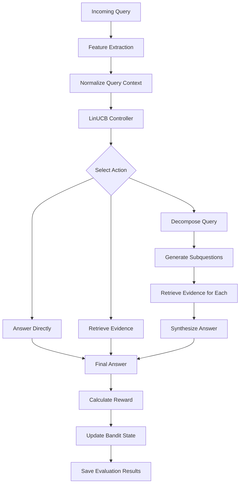

# Adaptive RAG Controller Using LinUCB

**An adaptive Retrieval-Augmented Generation (RAG) system that selects between direct answering, document retrieval, and query decomposition using a contextual-bandit approach.**


## Overview

Traditional Retrieval-Augmented Generation systems commonly retrieve documents before generating an answer. However, not every question requires retrieval, and complex questions may benefit from breaking the question into smaller subquestions.

This project explores an **adaptive RAG controller based on the Linear Upper Confidence Bound (LinUCB) contextual-bandit algorithm**. Given features extracted from a query, the controller chooses one of three actions:

- **Answer directly:** Generate an answer without retrieving documents.
- **Retrieve:** Retrieve relevant document chunks and generate an answer using the retrieved evidence.
- **Decompose:** Split a complex question into smaller subquestions, retrieve evidence for each, and synthesize a final answer.

The objective is to investigate whether adaptive action selection can improve the trade-off between reference-based answer quality, evidence support, and response latency.

The implementation was evaluated against a manually configured router and a Naive RAG baseline on a benchmark containing 200 queries across three categories.

## Research question

Can a LinUCB-based contextual-bandit controller adaptively select RAG actions for different query types and improve performance under an action-dependent reward function?

The project evaluates three systems:

1. LinUCB-based adaptive routing.
2. Rule-based Manual Router.
3. Naive RAG, which retrieves documents for every query.

The current results are preliminary experimental findings. Higher reward under the implemented reward function does not, by itself, establish better factual accuracy or generalization to unseen datasets.

## Architecture



The controller uses query-derived features to estimate the reward associated with available actions. The selected action is executed, and the resulting answer and evaluation metrics are recorded.

The precise update schedule and exploration configuration should be taken from the implementation in `pipeline/bandit/linucb.py` and the CP5 evaluation script.

## Technology stack

| Component | Technology |
|---|---|
| Programming language | Python |
| Language model API | Groq API |
| LLM integration | OpenAI-compatible Groq client |
| Vector database | ChromaDB |
| Embeddings | Sentence Transformers |
| Embedding model | `all-MiniLM-L6-v2` |
| Faithfulness estimation | `cross-encoder/nli-deberta-v3-base` |
| Contextual-bandit algorithm | LinUCB |
| Numerical computation | NumPy |
| Data analysis | Pandas |
| Statistical testing | SciPy |
| Visualization | Matplotlib |
| Evaluation storage | CSV files and NumPy state files |

## Adaptive routing actions

### 1. Direct answering

The `answer_directly` action generates an answer without retrieving documents from ChromaDB.

This action is intended to avoid retrieval overhead for questions that can be answered adequately without external evidence.

### 2. Retrieval

The `retrieve` action:

1. Encodes the query using the embedding model.
2. Searches the ChromaDB collection.
3. Retrieves the top-k document chunks.
4. Passes the evidence to the answer-generation function.
5. Records the retrieved evidence and final answer.

The current retrieval implementation uses `k=5` by default.

### 3. Query decomposition

The `decompose` action:

1. Uses the language model to generate up to three subquestions.
2. Retrieves evidence for each subquestion.
3. Generates answers for the subquestions.
4. Synthesizes a final answer to the original question.

This action is intended for complex questions that may require multiple pieces of information.

## Query context features

The feature extractor uses eight query features to construct the contextual-bandit input.

| Feature | Description |
|---|---|
| `query_length` | Query length |
| `num_words` | Number of words in the query |
| `has_compare` | Comparison-related query indicator |
| `has_relationship` | Relationship-related query indicator |
| `has_how` | Indicator for how-type questions |
| `is_definition` | Definition-question indicator |
| `num_concepts` | Estimated number of concepts |
| `complexity_score` | Estimated query complexity |

The features are processed by `pipeline/bandit/context.py`, which provides `build_context(features)` to normalize the context values.

These features represent the information provided to the routing policy. They do not guarantee that the query's true difficulty or required action is identified correctly.

## LinUCB algorithm

LinUCB is a contextual-bandit algorithm that balances exploitation and exploration.

For an action \(a\), the estimated parameter vector in a standard LinUCB formulation is:

\[
\hat{\theta}_a=A_a^{-1}b_a
\]

The action-selection score for context vector \(x\) is:

\[
p_a(x)=x^\top\hat{\theta}_a+
\alpha\sqrt{x^\top A_a^{-1}x}
\]

Where:

- \(x\) is the query context.
- \(A_a\) is the action-specific context matrix.
- \(b_a\) is the action-specific accumulated reward-weighted context.
- \(\hat{\theta}_a\) estimates the reward for an action.
- \(\alpha\) controls the exploration bonus.

The selected action is:

\[
a^*=\arg\max_a p_a(x)
\]

The first term estimates expected reward, while the second encourages exploration when uncertainty is higher.

These equations describe the standard LinUCB formulation. The exact update equations, initialization, and exploration coefficient should be verified against the implementation before treating them as a complete specification of the code.

The project also includes a warm-start mechanism in `pipeline/bandit/warm_start.py`. The CP5 execution logs reported 15 observations loaded from Checkpoint 4.

## Reward function

The current implementation uses an **action-dependent reward function**.

### Direct-answer reward

For `answer_directly`:

\[
R_{\mathrm{direct}}=0.8Q+0.2L
\]

### Retrieval and decomposition reward

For retrieval-based actions:

\[
R_{\mathrm{retrieval}}
=0.4F+0.3Q+0.2P+0.1L
\]

Where:

- \(Q\): Reference-based semantic answer similarity.
- \(F\): NLI- and similarity-based faithfulness estimate.
- \(P\): Mean retrieval similarity score.
- \(L\): Latency score.

The final reward is clipped to the interval \([0,1]\).

### Important evaluation limitation

The two formulas use different components and weights. Direct answering receives 80% of its reward from answer quality, while retrieval-based actions receive 30%.

Consequently, mean reward is an implementation-defined objective rather than an action-independent measure of answer quality. Reward comparisons must be interpreted in the context of this design.

The current evaluation therefore reports reference-based answer quality separately as a common outcome metric across all three systems.

## Evaluation methodology

### Benchmark composition

The evaluation benchmark contains 200 queries.

| Query category | Number of queries | Percentage |
|---|---:|---:|
| Simple | 80 | 40% |
| Multi-hop | 70 | 35% |
| Comparison | 50 | 25% |
| **Total** | **200** | **100%** |

Each system was evaluated on the same query set.

\[
N_{\mathrm{evaluations}}=200\times3=600
\]

### Compared systems

| System | Description |
|---|---|
| LinUCB | Contextual-bandit-based adaptive routing |
| Manual Router | Rule-based routing |
| Naive RAG | Retrieval-based baseline |

### Evaluation metrics

**Reference-based semantic answer similarity**

Generated answers are embedded using `all-MiniLM-L6-v2`. The implementation compares an answer with reference chunks, maps cosine similarity to the interval \([0,1]\), and selects the highest similarity.

\[
S(a,r)=\frac{\cos(e_a,e_r)+1}{2}
\]

\[
Q(a,R)=\max_{r\in R}S(a,r)
\]

This metric estimates semantic similarity to the best-matching reference chunk. It does not independently verify every factual claim or the completeness of an answer.

**Faithfulness estimate**

The implementation combines NLI entailment, contradiction probabilities, and semantic similarity between answer claims and retrieved evidence. The resulting score is an automated estimate of evidence support, not a guarantee of factual correctness.

**Mean retrieval similarity score**

The implementation averages the stored distance-derived scores of retrieved chunks. This is not conventional information-retrieval precision based on independent relevance labels.

**Latency**

The elapsed response time is recorded in seconds. The exact latency-score transformation is defined in `pipeline/reward/latency.py`.

## Experimental results

The following values were recomputed from the completed CP5 results file, `checkpoint5_results.csv`.

### Overall performance

| Metric | LinUCB | Manual Router | Naive RAG |
|---|---:|---:|---:|
| Mean reward | **0.8218** | 0.6627 | 0.5258 |
| Mean answer quality | **0.9007** | 0.8985 | 0.8922 |
| Mean faithfulness estimate* | 0.4503 | 0.3835 | 0.3768 |
| Mean retrieval similarity* | 0.0634 | 0.0789 | 0.0804 |
| Mean latency (seconds) | 2.7449 | 9.6963 | 2.5954 |
| Mean latency score | 0.9272 | 0.6880 | 0.9128 |

\*Faithfulness and retrieval similarity are calculated only for rows where these metrics were defined. They do not have 200 observations per system.

### Key observations

- LinUCB recorded the highest mean reward under the implemented reward function.
- Mean reference-based answer-quality scores were relatively similar across all three systems.
- LinUCB had a lower mean latency than Manual Router in this evaluation.
- Naive RAG had the lowest mean latency, although the difference from LinUCB was small in absolute terms.
- Retrieval-specific metrics cannot be compared as if they were measured on all queries because direct-answer actions leave these metrics undefined.

These are observations from the current benchmark and should not be interpreted as proof of generalization to unseen queries.

### Category-specific reward

| Category | LinUCB | Manual Router | Naive RAG |
|---|---:|---:|---:|
| Simple | **0.9402** | 0.9291 | 0.5256 |
| Multi-hop | **0.8789** | 0.5038 | 0.5219 |
| Comparison | **0.5524** | 0.4590 | 0.5315 |

The largest observed reward differences occur in the multi-hop category. The reward difference is smaller for comparison questions, where Naive RAG records a mean reward relatively close to LinUCB.

These values represent the action-dependent reward, not a category-wise measurement of factual accuracy.

## LinUCB action distribution

The controller selected the following actions across 200 queries.

| Action | Count | Percentage |
|---|---:|---:|
| Answer directly | 146 | 73.0% |
| Retrieve | 39 | 19.5% |
| Decompose | 15 | 7.5% |
| **Total** | **200** | **100%** |

The distribution shows that direct answering was the most frequently selected action in this experiment. Action frequency alone does not establish that the routing decisions were optimal.

## Statistical analysis

The initial validation script performed paired Wilcoxon signed-rank tests and calculated bootstrap confidence intervals for paired mean differences. It also applied Holm-Bonferroni correction to the reported families of tests.

Selected results from that analysis are shown below.

| Metric | Comparison | Mean difference | 95% bootstrap CI | Holm-adjusted p-value |
|---|---|---:|---|---:|
| Reward | LinUCB vs Manual Router | +0.1591 | [0.1315, 0.1869] | Reported as 0.000000 |
| Reward | LinUCB vs Naive RAG | +0.2961 | [0.2665, 0.3244] | Reported as 0.000000 |
| Answer quality | LinUCB vs Manual Router | +0.0022 | [-0.0083, 0.0094] | 0.038125 |
| Answer quality | LinUCB vs Naive RAG | +0.0085 | [-0.0106, 0.0297] | 0.526399 |
| Latency | LinUCB vs Manual Router | -6.9514 s | [-8.8253, -5.1943] | Reported as 0.000000 |
| Latency | LinUCB vs Naive RAG | +0.1496 s | [-0.8327, 1.2640] | Reported as 0.000000 |

The displayed values of `0.000000` are rounded outputs, not literal zero probabilities. The underlying unrounded p-values should be checked before reporting a threshold such as \(p<0.001\).

The initial analysis also showed cases where Wilcoxon test results and bootstrap confidence intervals led to different apparent conclusions. A later paired-permutation analysis was prepared to investigate the primary answer-quality comparisons. Its final output should be checked before these statistical claims are considered final.

Statistical significance on this benchmark does not establish generalization to unseen questions.

## Generated figures and reports

The project generates three principal research figures:

1. `figure1_overall_performance.png` — overall reward and answer quality.
2. `figure2_category_comparison.png` — reward across simple, multi-hop, and comparison queries.
3. `figure3_action_distribution.png` — LinUCB action counts and percentages.

The existing analysis also generates validation summaries and statistical result tables in `results/checkpoint5/`.

The figure error bars in the initial plots represent standard deviations, not confidence intervals. This distinction should be retained in figure captions.

## Project structure

The following is a representative structure based on the project files used during CP5. Confirm the current repository before publishing because earlier checkpoints and auxiliary scripts may differ.

```text
adaptive_rag/
├── data/
│   └── queries/
│       ├── evaluation_queries.csv
│       └── full_references_frozen.csv
├── eval/
│   ├── checkpoint5_full_eval.py
│   ├── plot_checkpoint5.py
│   ├── validate_checkpoint5.py
│   └── finalize_checkpoint5_analysis.py
├── pipeline/
│   ├── actions/
│   │   ├── answer_directly.py
│   │   ├── retrieve.py
│   │   ├── decompose.py
│   │   └── common.py
│   ├── bandit/
│   │   ├── context.py
│   │   ├── linucb.py
│   │   └── warm_start.py
│   ├── reward/
│   │   ├── answer_quality.py
│   │   ├── faithfulness.py
│   │   ├── retrieval_precision.py
│   │   ├── latency.py
│   │   └── reward_function.py
│   ├── adaptive_router.py
│   ├── feature_extractor.py
│   └── naive_rag.py
├── results/
│   └── checkpoint5/
│       ├── checkpoint5_results.csv
│       ├── checkpoint5_summary.csv
│       ├── checkpoint5_category_summary.csv
│       ├── checkpoint5_action_summary.csv
│       ├── checkpoint5_linucb_learning.csv
│       ├── linucb_state.npz
│       └── final_analysis/
├── .env.example
├── .gitignore
├── requirements.txt
└── README.md
```

Some files in this tree may be optional or may not exist in every version of the repository. Keep the README aligned with the actual committed files.

## Installation

### Prerequisites

- Python 3.11 recommended for the current development environment.
- A Groq API key for LLM calls.
- Access to the evaluation data and required embedding/NLI models.
- Sufficient disk space for downloaded models and the ChromaDB collection.

### 1. Clone the repository

```bash
git clone <YOUR_GITHUB_REPOSITORY_URL>
cd adaptive_rag
```

Replace the placeholder with your actual repository URL.

### 2. Create a virtual environment

Windows PowerShell:

```powershell
python -m venv .venv
.\.venv\Scripts\Activate.ps1
python -m pip install --upgrade pip
```

### 3. Install dependencies

If the repository includes `requirements.txt`:

```powershell
python -m pip install -r requirements.txt
```

If dependencies are not fully listed in that file, verify the packages imported by the actual code before installing additional packages.

### 4. Configure environment variables

Create a local `.env` file in the project root using the environment-variable names expected by the application.

For example, if the code expects `GROQ_API_KEY`:

```dotenv
GROQ_API_KEY=your_groq_api_key_here
```

Use the exact variable names required by the current implementation. Never commit the real `.env` file, API keys, access tokens, or credentials.

### 5. Prepare the data and vector database

Ensure the evaluation queries and frozen reference file are available at the paths expected by the scripts.

If the ChromaDB collection is not already present, run the repository's actual data-ingestion or indexing procedure before executing an evaluation.

The original CP5 results were produced using a prepared ChromaDB collection. Reproducing those exact results requires the same corpus, configuration, models, references, and evaluation implementation.

## Running the evaluation

### Validate the existing CP5 results

```powershell
python eval/validate_checkpoint5.py
```

This script checks the result row count, system distribution, duplicate system/query pairs, query coverage, category counts, and selected metric values. It also generates summary tables and paired statistical analysis when its validation checks pass.

### Generate the CP5 plots

```powershell
python eval/plot_checkpoint5.py
```

Check the script's output paths before running it.

### Run the final common-metric analysis

If `eval/finalize_checkpoint5_analysis.py` is present:

```powershell
python eval/finalize_checkpoint5_analysis.py
```

This script is intended to compare reference-based answer quality using paired observations, calculate bootstrap confidence intervals, run paired permutation tests, and generate the three figures.

### Run the full CP5 evaluation

The full evaluation entry point used in the project is:

```powershell
python eval/checkpoint5_full_eval.py
```

**Warning:** This command can call the language-model API and perform retrieval and answer generation. It may take time, consume API quota, and update evaluation outputs or the LinUCB state. Do not rerun it merely to inspect existing results.

Inspect the script and its resume/state-handling behavior before starting a new experiment.

## Validation findings

The completed CP5 validation reported:

- 600 total evaluations.
- 200 evaluations per system.
- Zero duplicate system/query pairs.
- 200 unique query IDs per system.
- Matching query coverage across the three systems.
- Correct category counts for all systems.
- No missing reward or answer-quality values.
- No missing faithfulness or retrieval-relevance values on retrieval-based actions.

There were 226 undefined faithfulness and retrieval-relevance values, corresponding to the 226 direct-answer evaluations. These are intentional under the current implementation, which does not calculate retrieval-based metrics for direct answers.

They should not be imputed with zero.

The validation checks establish structural consistency for the fields checked by the script. They do not independently establish that the reference answers are correct or that the evaluation methodology is free from bias.

## Reproducibility and data management

For a reproducible experiment, preserve:

- The exact query benchmark.
- The frozen reference answers.
- The knowledge-base corpus and indexing configuration.
- The LinUCB implementation and warm-start state.
- The reward and metric implementations.
- The evaluation scripts and dependency versions.
- The raw results CSV and generated analysis files.
- The model identifiers and relevant configuration values.

The existing `linucb_state.npz` contains saved numerical state. Treat it as part of the experiment record if the evaluation depends on it.

Generated result files should be versioned intentionally. Large local databases, virtual environments, API keys, and temporary caches should not be committed accidentally.

## Limitations

The current study has several limitations.

1. **Action-dependent reward:** Direct answering and retrieval-based actions use different reward formulas, limiting the interpretation of cross-system reward differences.
2. **Reference-based similarity:** The answer-quality metric measures semantic similarity to the best-matching reference chunk, not complete factual correctness.
3. **Retrieval metric:** The implemented retrieval score averages distance-derived similarity scores rather than using independently labelled relevance judgments.
4. **Automated faithfulness:** The faithfulness estimate depends on the NLI model, embedding model, and heuristic thresholds.
5. **Benchmark size:** The experiment covers 200 queries from three categories. Generalization to unseen datasets has not been established.
6. **Latency variability:** Observed latency depends on the model API, hardware, retrieval setup, and execution conditions.
7. **Statistical audit:** The final common-metric statistical analysis should be preserved and checked before making definitive significance claims.
8. **Related work:** Novelty relative to existing adaptive RAG and contextual-bandit methods requires a dedicated literature review.

## Future work

Potential next steps include:

- Evaluate the controller on additional query benchmarks.
- Compare answer quality using a common metric across all systems.
- Add human-reviewed factuality and evidence-support evaluations.
- Replace similarity-derived retrieval scores with relevance-labelled retrieval metrics.
- Investigate a reward formulation that supports fairer comparisons between actions.
- Conduct ablation studies on context features and reward components.
- Evaluate sensitivity to the LinUCB exploration coefficient.
- Measure routing overhead and end-to-end latency under consistent conditions.
- Compare against additional adaptive RAG baselines.
- Improve reproducibility through fixed configurations and versioned datasets.

## Research summary

This project implements a LinUCB-based adaptive RAG controller that selects among direct answering, retrieval, and query decomposition using an eight-feature query context.

In the completed CP5 experiment, the three systems were evaluated on the same 200 queries, producing 600 system-query evaluations. LinUCB achieved the highest mean reward under the current action-dependent reward function, while reference-based semantic answer-quality scores were relatively similar across systems.

These findings motivate further study of adaptive RAG routing, but they do not yet establish superior factual accuracy or generalization to unseen queries.

## Acknowledgements

This project uses open-source software and pretrained models, including Sentence Transformers, ChromaDB, Transformers, SciPy, NumPy, Pandas, and Matplotlib, together with a Groq-hosted language model.


## License

MIT Licensed

